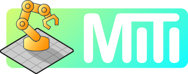

<div align="center">
  

# MITI

**A web dashboard for watching and driving ROS 2 robots from any browser.**

[](https://github.com/hiran-t/MITI/releases/latest)
[](https://github.com/hiran-t/MITI/actions/workflows/ci.yml)
[](https://docs.ros.org/)
[](LICENSE)

</div>

MITI shows a robot's 3D scene, cameras, logs and state machines in tiled panels, in the browser. It connects to [foxglove_bridge](https://github.com/foxglove/foxglove-sdk) over the Foxglove WebSocket protocol and works the way Foxglove's panels do, so teams that know Foxglove feel at home. foxglove_bridge can run on the robot, or on the MITI machine, where it reads the robot's topics over DDS and keeps the work off the robot.

## Contents

- [Features](#features)
- [Requirements](#requirements)
- [Install and run](#install-and-run)
- [Set up foxglove_bridge](#set-up-foxglove_bridge)
- [Configuration](#configuration)
- [Using MITI](#using-miti)
- [Development](#development)
- [Documentation](#documentation)
- [Troubleshooting](#troubleshooting)
- [Contributing](#contributing)
- [License](#license)

## Features

- **3D Scene** like Foxglove's 3D panel: robot model from `/robot_description` with live joints, TF, point clouds and laser scans, occupancy grids and costmaps, poses, paths, markers, and publishing goal poses. See [docs/3d-scene.md](docs/3d-scene.md).
- **Camera** like Foxglove's Image panel: raw and compressed images, 3D topics drawn over the image through `camera_info` and TF, color maps for depth images, flip, rotation and rectify.
- **Log** for `/rosout`, with level, text and node filters and a color per node.
- **Topics**, **Point Cloud**, **State Machine** (SMACC2 and BehaviorTree) and **Button Switch** panels.
- **Workspace**: tiled panels you drag, split and resize; an activity bar for panel settings, topics, problems and sources; layouts saved in the browser.
- **Built for heavy data**: decoding runs in Web Workers, and panels skip frames they would not draw.
- **Runs anywhere**: one `pixi run miti`, or Docker Compose as a service; optional foxglove_bridge beside MITI.

## Requirements

| To run           | You need                                                                     |
| ---------------- | ---------------------------------------------------------------------------- |
| MITI with pixi   | [pixi](https://pixi.sh); it brings Node.js (and ROS 2 for the bridge) itself |
| MITI with Docker | Docker with Compose v2                                                       |
| MITI from source | Node.js 22 and npm (or [Bun](https://bun.sh))                                |
| The robot        | ROS 2 Humble or Jazzy, and foxglove_bridge on the robot or beside MITI       |

Linux (x86-64, ARM64), macOS (Apple silicon) and Windows (x86-64) are supported; on Windows see [Windows](docs/DEPLOYMENT.md#windows). Browsers: current Chrome, Edge, Firefox or Safari.

## Install and run

```bash
git clone https://github.com/hiran-t/MITI.git
cd MITI
```

### Option 1: pixi (recommended)

Install pixi once:

```bash
# Linux and macOS
curl -fsSL https://pixi.sh/install.sh | sh
# then open a new terminal, or: source ~/.bashrc (zsh: source ~/.zshrc)
```

```powershell
# Windows (PowerShell); then open a new terminal
powershell -ExecutionPolicy ByPass -c "irm -useb https://pixi.sh/install.ps1 | iex"
```

Run MITI:

```bash
pixi run miti          # http://<this machine>:3000
pixi run miti 8080     # on another port (a taken port moves to the next free one)
pixi run remove        # delete everything pixi and the build generated; pixi run miti restores it
```

The first run installs Node.js and the npm packages and builds MITI; later runs start in about a second unless the source changed.

### Option 2: Docker Compose (as a service)

Install Docker once on Ubuntu, if it is not there yet:

```bash
curl -fsSL https://get.docker.com | sh
sudo usermod -aG docker $USER   # log out and in again
sudo systemctl enable --now docker
```

Run MITI; it restarts with the machine:

```bash
docker compose up -d           # http://<this machine>:3000
docker compose logs -f         # logs
docker compose up -d --build   # rebuild after updating MITI
docker compose down            # stop
```

### Option 3: apt package (Ubuntu 22.04 and 24.04, amd64 and arm64)

No clone needed. Add MITI's apt repository once, then install; `sudo apt upgrade` keeps it current:

```bash
curl -fsSL https://hiran-t.github.io/MITI/key.gpg | sudo gpg --dearmor -o /usr/share/keyrings/miti.gpg
echo "deb [signed-by=/usr/share/keyrings/miti.gpg] https://hiran-t.github.io/MITI stable main" | sudo tee /etc/apt/sources.list.d/miti.list
sudo apt-get update
sudo apt-get install miti         # http://<this machine>:3000, starts at boot
```

Settings are in `/etc/miti/miti.env`; see [docs/DEPLOYMENT.md](docs/DEPLOYMENT.md#apt-package-ubuntu).

### Option 4: from source

```bash
npm ci
npm run build && npm start     # production, http://localhost:3000
npm run dev                    # development with hot reload
```

## Set up foxglove_bridge

MITI needs foxglove_bridge (WebSocket, port 8765) somewhere it can reach. Choose one place for it.

### On the robot

Install it with the robot's ROS 2 (replace `humble` with `jazzy` on a Jazzy robot):

```bash
sudo apt update
sudo apt install ros-humble-foxglove-bridge
```

Start it:

```bash
source /opt/ros/humble/setup.bash
ros2 launch foxglove_bridge foxglove_bridge_launch.xml
```

In MITI, open the connection settings (gear in the status bar, bottom left) and enter `ws://<robot-ip>:8765`.

### Beside MITI (keeps the work off the robot)

foxglove_bridge runs on the MITI machine and subscribes to the robot's topics over DDS, only for the topics someone is viewing. Nothing is installed on the robot; the two machines must be on the same network with the same `ROS_DOMAIN_ID`, and the bridge must use the robot's ROS 2 distro. With `miti-bridge`, the connection settings in MITI change the bridge's `ROS_DOMAIN_ID` and robot address and restart it.

```bash
pixi run -e humble miti-bridge          # MITI + foxglove_bridge (use -e jazzy for a Jazzy robot)
pixi run -e humble bridge               # foxglove_bridge only

docker compose --profile bridge up -d   # the same with Docker (Linux only: needs host networking)
```

MITI connects to the bridge beside it by itself. The bridge offers topics whose message types it knows: the standard ROS packages are included; add the robot's own message packages to `ros/overlay/src` and run `pixi run -e humble build-msgs`. Settings, DDS tuning for Wi-Fi and troubleshooting are in [docs/DEPLOYMENT.md](docs/DEPLOYMENT.md#foxglove_bridge-beside-miti).

## Configuration

MITI needs no configuration. Optional settings go in `.env` (copy [.env.example](.env.example)); Docker Compose and Next.js both read it.

| Variable                 | Default                                 | Meaning                                                                           |
| ------------------------ | --------------------------------------- | --------------------------------------------------------------------------------- |
| `NEXT_PUBLIC_BRIDGE_URL` | `ws://<host MITI was opened from>:8765` | Bridge address MITI opens first; built into the app, so rebuild after changing it |
| `MITI_PORT`              | `3000`                                  | Port for Docker Compose                                                           |
| `COMPOSE_PROFILES`       | —                                       | `bridge` to always start foxglove_bridge with Docker Compose                      |
| `ROS_DISTRO`             | `humble`                                | Bridge image distro (Docker)                                                      |
| `ROS_DOMAIN_ID`          | `0`                                     | Must match the robot                                                              |
| `ROS_STATIC_PEERS`       | —                                       | The robot's IP, for networks that drop multicast (Wi-Fi)                          |
| `RMW_IMPLEMENTATION`     | `rmw_fastrtps_cpp`                      | Or `rmw_cyclonedds_cpp`                                                           |
| `BRIDGE_TOPIC_WHITELIST` | `['.*']`                                | Regexes of topics the bridge offers                                               |

The address in the connection settings always wins and is remembered per browser.

## Using MITI

- **Connect**: the status bar (bottom left) shows the bridge address and state; the gear opens the connection settings.
- **Add panels** with **+** in the title bar. Drag a panel's tab onto another panel's edge to split it, drag dividers to resize, and use the expand and lock buttons on each tab.
- **Configure a panel**: click its tab; its settings open in the sidebar. The activity bar on the left switches between Panel settings, Topics, Problems and Sources.
- **3D Scene**: set _Display frame_ to a robot frame (for example `base_link`) to follow the robot, and turn topics on with the eye icons, as in Foxglove.
- **Camera**: pick the image topic in its settings; turn on _Calibration_ and topics to draw them over the image.

## Development

```bash
npm ci
npm run dev            # http://localhost:3000
npm test               # unit tests (Jest)
npm run type-check     # TypeScript
npm run lint           # ESLint
npm run format         # Prettier
```

A pre-commit hook runs ESLint and Prettier on staged files. Stack: Next.js 14, React 18, TypeScript, Tailwind CSS, three.js with React Three Fiber, react-mosaic.

```
src/
├── app/                   Next.js app, global styles, API routes
├── components/features/   dashboard shell, layout, connection, topics, logs, controls, visualization
├── hooks/                 useBridge, useTopic, useTF, useLayoutConfig, …
├── lib/                   foxglove_bridge client and decode workers, parsers, scene and camera math, theme
├── styles/                shared Tailwind class sets
└── types/                 message, widget and scene types
pixi.toml                  pixi tasks and environments
docker-compose.yml         MITI service and the bridge profile
ros/                       foxglove_bridge script, image and message overlay
scripts/                   load harness, deployment helpers
```

To add a panel type, see [docs/ARCHITECTURE.md](docs/ARCHITECTURE.md). To measure performance under robot-sized data, see [docs/PERFORMANCE.md](docs/PERFORMANCE.md).

## Documentation

| Document                                                             | Contents                                                              |
| -------------------------------------------------------------------- | --------------------------------------------------------------------- |
| [docs/DEPLOYMENT.md](docs/DEPLOYMENT.md)                             | pixi, Docker, foxglove_bridge beside MITI, DDS, environment variables |
| [docs/3d-scene.md](docs/3d-scene.md)                                 | 3D Scene settings and layers                                          |
| [docs/STATE_MACHINE_MONITORING.md](docs/STATE_MACHINE_MONITORING.md) | State Machine panel                                                   |
| [docs/ARCHITECTURE.md](docs/ARCHITECTURE.md)                         | How MITI is built                                                     |
| [docs/API.md](docs/API.md)                                           | Hooks, bridge client and types                                        |
| [docs/PERFORMANCE.md](docs/PERFORMANCE.md)                           | Load harness and measurements                                         |
| [docs/RELEASES.md](docs/RELEASES.md)                                 | How releases are made                                                 |
| [CHANGELOG.md](CHANGELOG.md)                                         | What changed in each version                                          |

## Troubleshooting

| Problem                                  | What to check                                                                                                                               |
| ---------------------------------------- | ------------------------------------------------------------------------------------------------------------------------------------------- |
| Status bar says Disconnected             | foxglove_bridge is running and port 8765 is reachable (`ros2 node list \| grep foxglove`, firewall); the address in the connection settings |
| Connected, but a panel waits for data    | The panel's topic exists (Topics view in the activity bar); names differ between robots, e.g. `/camera/camera/color/image_raw`              |
| 3D Scene looks empty                     | _Display frame_ set to a robot frame; topics turned on (eye icons)                                                                          |
| Bridge beside MITI sees few or no topics | Same `ROS_DOMAIN_ID` and ROS 2 distro as the robot; see [DDS tips](docs/DEPLOYMENT.md#network-and-dds)                                      |
| Bridge log: `package '...' not found`    | The bridge lacks that message type; add the package to `ros/overlay/src` and run `build-msgs`                                               |
| Bridge moved to another port             | Another program holds 8765; the bridge used the next free port and MITI follows it. The message names that program                          |
| Robot model has no meshes                | The bridge serves `package://` meshes; with the bridge beside MITI, the robot's description package must be on that machine too             |

## Contributing

Questions, ideas and setups using MITI are welcome in [Discussions](https://github.com/hiran-t/MITI/discussions). Contributions are welcome too. Read [CONTRIBUTING.md](CONTRIBUTING.md), and the [Code of Conduct](CODE_OF_CONDUCT.md). Report security issues as described in [SECURITY.md](SECURITY.md).

## License

[MIT](LICENSE). MITI builds on [ROS 2](https://docs.ros.org/), [foxglove_bridge](https://github.com/foxglove/foxglove-sdk), [three.js](https://threejs.org/), [React Three Fiber](https://docs.pmnd.rs/react-three-fiber/), [Next.js](https://nextjs.org/), [Tailwind CSS](https://tailwindcss.com/), [react-mosaic](https://github.com/nomcopter/react-mosaic) and [urdf-loader](https://github.com/gkjohnson/urdf-loaders).
